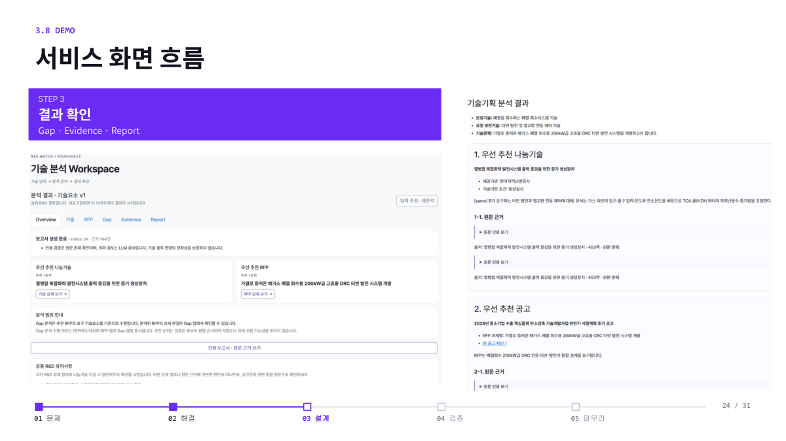
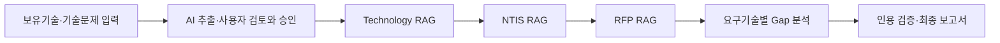
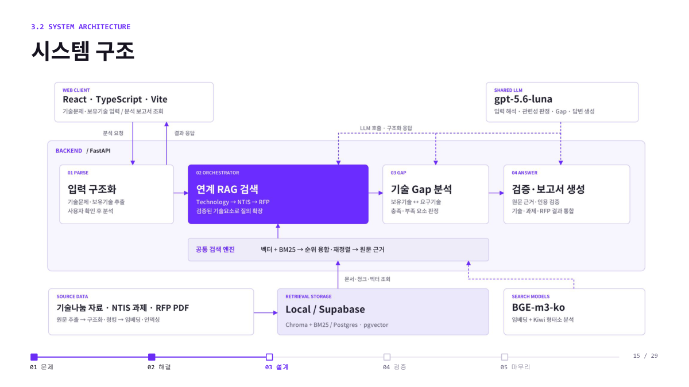

# 잇다(ITDA) · MatchingRND

**보유기술과 기술문제를 외부기술·국가 R&D 과제·RFP로 연결하는 근거 기반 기술기획 지원 RAG 서비스입니다.**

제조·자동화 기업의 R&D 담당자가 보유기술, 개발 목표, 확보하고 싶은 기술을 입력하면 관련 기술나눔 자료와 선행 연구과제, 공고의 요구기술을 단계적으로 탐색합니다. 이후 RFP 요구기술과 보유·외부기술을 비교해 **어떤 부분을 활용할 수 있고, 무엇을 추가 검토해야 하는지** 원문 인용과 함께 보여줍니다.

잇어빌리티 팀의 최종 프로젝트이며, 이 저장소는 React 프런트엔드, FastAPI 백엔드, 자료별 RAG, 기술 Gap 분석과 보고서 생성을 포함합니다.

## 프로젝트 배경

기업은 해결하려는 문제를 중심으로 기술을 설명하지만, 기술나눔 자료와 R&D 사업은 각각 다른 용어와 형식으로 작성됩니다. 담당자는 흩어진 PDF·Excel 자료를 개별적으로 찾고, 유사한 기술이 실제 개발 목표에도 맞는지 다시 비교해야 합니다.

잇다는 이 탐색과 비교를 하나의 흐름으로 연결합니다. 문서 목록과 유사도만 제공하는 대신, 관련 후보의 원문과 요구기술별 판단 근거까지 확인할 수 있도록 설계했습니다.

> **사용 예시**
>
> “폐열 회수시스템 기술을 가지고 있습니다. 200kW급 ORC 터빈 발전 시스템을 개발하기 위해 터빈 발전과 열교환 연동 제어 기술을 확보하고 싶은데, 관련 나눔기술과 공고가 있을까요?”

이 입력에서 보유기술과 요청기술을 분리하고, 사용자가 기술요소를 검토·승인한 뒤 기술 탐색과 RFP 요구기술 비교를 실행합니다. 관련 후보를 찾았다는 사실과 요구기술을 충족한다는 판단은 구분합니다.

## 주요 기능

| 기능 | 제공 내용 |
| --- | --- |
| 입력 구조화·검토 | 자연어에서 보유기술·개발 목표·요청기술을 추출하고 사용자가 수정·승인 |
| 기술나눔 탐색 | 요청기술과 같거나 유사한 외부기술을 검색하고 원문에서 관련 기술요소 추출 |
| NTIS 선행과제 탐색 | 보유기술·목표와 관련된 국가 R&D 사례, 기술용어, 연구주제 확인 |
| RFP 연결 | 관련 공고·과제를 찾고 개발목표·요구기술·성능지표·실증조건을 구조화 |
| 기술 Gap 분석 | RFP 요구기술마다 보유기술·외부기술과의 충족 관계를 비교하고 판정 근거 제시 |
| 근거·보고서 조회 | 기술·RFP·Gap·Evidence·Report 화면에서 원문 인용과 분석 결과 확인 |

### 서비스 화면

최종 발표자료에 수록한 분석 결과 화면입니다. 추천 기술·RFP에서 개별 근거와 전체 보고서로 이동할 수 있습니다.



## 분석 흐름



- **Cascade 검색:** 앞 단계에서 원문 근거가 확인된 기술요소만 다음 단계의 질의 확장에 사용하며, 최초 기술문제는 유지합니다.
- **하이브리드 검색:** BM25·Kiwi의 용어 검색과 BGE-m3-ko의 의미 검색을 RRF로 결합합니다. 기본 리랭커는 OFF입니다.
- **자료별 청킹:** 기술나눔은 의미가 가까운 섹션을 묶고, NTIS는 과제의 연구 맥락을 보존하며, RFP는 과제·항목·성능표 구조와 페이지·좌표를 유지합니다.
- **판단과 검증의 분리:** LLM이 관련성과 충족도를 판단하고, 코드는 인용의 원문 일치와 판정 규칙을 검사합니다. 최종 설명의 근거 지지 여부도 별도 의미 검토를 수행합니다.

### 기술 Gap의 다섯 가지 판정

| 판정 | 의미 |
| --- | --- |
| 기존보유 | 입력한 보유기술이 요구기술을 충족하는 것으로 판단 |
| 외부기술보완 | 검증된 기술나눔 후보로 요구기술을 보완할 수 있는 것으로 판단 |
| 부분충족 | 보유기술 또는 외부기술이 요구의 일부만 충족 |
| 추가 R&D 검토 후보 | RFP에 요구가 명시되어 있으나 보유·외부기술의 충족 근거가 확인되지 않음 |
| 근거부족 | 요구나 근거가 불명확해 판단하기 어려움 |

검색 결과가 없다는 이유만으로 기술 미보유나 추가 R&D 필요를 판정하지 않습니다. NTIS 사례는 선행 연구의 참고 자료이며 Gap 충족 판정의 단독 근거로 사용하지 않습니다.

## 시스템 구성



| 영역 | 기술·구성 |
| --- | --- |
| 프런트엔드 | React, TypeScript, Vite, React Bootstrap |
| API | Python, FastAPI, Pydantic |
| 자료 처리 | PyMuPDF, pdfplumber, pandas, Excel·PDF 파서 |
| 검색 | BGE-m3-ko, Kiwi, BM25, RRF |
| 저장소 | Supabase PostgreSQL·pgvector, 로컬 Chroma·BM25 경로 지원 |
| LLM | 기본 `gpt-5.6-luna`; 공통 기본값은 `app/common/llm_config.py` |

Supabase 경로에서는 준비된 문서·청크·벡터를 조회하고 BM25를 메모리에 구성합니다. 질의마다 PDF 전체를 다시 파싱하거나 문서 전체를 재임베딩하지 않습니다. 명시적인 CLI·환경변수·모듈 설정은 LLM 기본값보다 우선할 수 있습니다.

## 사용 데이터

최종 발표자료의 수집·검수 집계 기준입니다.

| 자료 | 규모 | 활용 |
| --- | --- | --- |
| 공공기관·POSCO 기술나눔 | 298건 + 293건 = **591건** | 외부기술 탐색, 기술요소·이전정보 확인 |
| NTIS 2026 기계 분야 과제 | **6,580건** | 선행 연구과제·관련 기술 맥락 탐색 |
| 국가 R&D RFP·공고목록 | 수집 PDF **238개**, 검수 승인 **416과제·1,633청크** | 공고 연결, 요구기술·성능지표 추출 |
| KIPRIS 특허 시나리오 자료 | **9,573건** | 시나리오 구성 및 별도 특허 적재·검색 |

수집한 PDF 수, 검수·적재한 문서 수, PDF 내부의 과제 수는 서로 다른 집계 단위입니다. 실제 적재 상태는 `supabase_rag status`로 확인합니다. 시나리오 특허 자료는 사용자의 실제 기업 소유권을 입증하지 않으며, 통합 Gap 분석의 보유기술은 사용자 입력을 사용합니다.

## 실행 방법

### 1. 환경 준비

- Python 3.12 기준 실행 환경
- Node.js 22.12 이상 또는 24 이상
- LLM API 키와 Supabase PostgreSQL 접속 정보
- 사전 적재된 DB 또는 아래 경로의 원본 자료

프로젝트 루트에서 실행합니다. 아래 예시는 Windows PowerShell 기준이며, macOS·Linux에서는 가상환경을 `.venv/bin/activate`로 활성화합니다.

```powershell
python -m venv .venv
.\.venv\Scripts\Activate.ps1
python -m pip install -r requirements-dev.txt
python -m pip install PyMuPDF xlrd
Copy-Item .env.example .env
```

`.env`의 `OPENAI_API_KEY`, `SUPABASE_DB_HOST`, `SUPABASE_DB_PORT`, `SUPABASE_DB_NAME`, `SUPABASE_DB_USER`, `SUPABASE_DB_PASSWORD`를 설정합니다. 기본 검색 경로는 `RAG_BACKEND=supabase`입니다. DB 접속에는 Supabase **Session pooler** 정보를 사용하며 Data API secret key를 DB 비밀번호로 사용하지 않습니다.

GPU를 사용할 경우 환경에 맞는 CUDA 지원 PyTorch가 필요합니다. `RAG_EMBEDDING_DEVICE=auto`는 GPU가 없으면 CPU를 사용하고, `cuda`는 GPU 사용을 강제합니다. `.env`는 Git에 포함하지 않습니다.

### 2. 원본 자료와 검색 DB 준비

이미 자료가 적재된 Supabase를 사용하는 경우 `status`로 확인하고 다음 단계로 진행할 수 있습니다. 새 DB를 구축할 때는 다음 기본 경로에 자료를 준비합니다.

```text
data/raw/
├── technology/
│   ├── 4._2026년_공공기관_기술나눔_기술소개자료.pdf
│   ├── 2025년_포스코그룹_기술나눔_기술소개자료.pdf
│   ├── 2. 2026년 공공기관 기술나눔 목록(298건).xlsx
│   └── 나눔기술.xls
├── ntis/
│   └── ntis_projects_2026_mechanical.xlsx
└── rfp/
    ├── RFP_공고목록.xlsx
    └── pdf/
        └── 공고·RFP 원본 PDF
```

저장소의 일부 Excel 원본은 `data/raw/` 바로 아래에 있습니다. 전처리 전에 위 기본 경로로 복사하거나 모듈 설정에서 경로를 지정하세요. 원본 PDF·생성 인덱스·DB 접속 정보는 저장소에 모두 포함되어 있지 않으므로, clone만으로 전체 분석을 즉시 실행할 수는 없습니다.

기술나눔 문서·청크를 준비한 뒤 통합 분석에 사용하는 세 자료군을 적재합니다.

```powershell
python -m app.technology_rag.scripts.build_documents --reparse
python -m app.technology_rag.scripts.build_chunks --strategies section_group
python -m app.scripts.supabase_rag setup
python -m app.scripts.supabase_rag ingest --modules technology ntis rfp
python -m app.scripts.supabase_rag status
```

`ingest`는 변경된 자료군의 이전 스냅샷을 교체합니다. 같은 지문이면 재적재를 생략합니다. DB 구조·권한·적재 방법은 [Supabase 안내](docs/SUPABASE_SETUP.md)를 참고하세요.

### 3. API와 화면 실행

프로젝트 루트에서 API를 시작합니다.

```powershell
python -m uvicorn app.api.main:app --host 127.0.0.1 --port 8000
```

별도 터미널에서 프런트엔드를 실행합니다.

```powershell
cd frontend
Copy-Item .env.example .env.local
npm ci
npm run dev
```

- 화면: `http://localhost:5173`
- API 상태: `http://127.0.0.1:8000/api/health`
- API 문서: `http://127.0.0.1:8000/docs`
- 프런트엔드 API 주소: `frontend/.env.local`의 `VITE_API_BASE_URL`

Workspace에서 기술 정보를 입력하고 **AI 추출 → 기술요소 검토·승인 → 분석 실행 → 결과·근거·보고서 확인** 순으로 사용합니다. Discover는 데모와 실제 DB 검색을 구분합니다. 실제 입력 추출·분석 요청에는 LLM API 사용료가 발생할 수 있습니다.

### 4. CLI 실행

```powershell
python -m app.scripts.run_analysis --backend supabase --query "폐열 회수시스템을 보유하고 있으며 ORC 터빈 발전 시스템을 개발하기 위한 발전·열교환 연동 제어 기술과 관련 공고를 찾고 싶습니다."
```

결과는 기본적으로 `outputs/<실행 시각>/`에 저장됩니다.

| 파일 | 내용 |
| --- | --- |
| `input.json` | 자연어 입력 해석 결과 |
| `state.json` | 검색 결과·출처·질의 확장 이력 |
| `gap_llm.json` | 요구기술별 Gap 판정과 근거 |
| `answer_llm.json`, `answer_llm.md`, `answer.md` | 최종 분석 결과와 보고서 |
| `comparison.json` | 통합 실행 상태·단계별 오류 |

## 주요 API

| 메서드 | 경로 | 역할 |
| --- | --- | --- |
| GET | `/api/health` | API 연결 상태 |
| GET | `/api/capabilities` | 지원 범위·입력 근거의 성격 |
| GET | `/api/discovery/search` | 자료군별 실제 DB 탐색 |
| POST | `/api/analysis/extract` | 입력에서 기술요소 추출 |
| POST | `/api/analysis` | 자료별 RAG 검색 결과 반환 |
| POST | `/api/analysis/report-view` | 화면용 통합 분석 결과 반환 |
| POST | `/api/analysis/report` | 최종 보고서 반환 |

요청·응답 스키마는 실행 중인 API의 `/docs`에서 확인할 수 있습니다. 공통 RAG 반환형은 `app/common/schemas.py`의 `ModuleResult`이며, 공통 `Evidence.page`는 0부터 시작합니다.

## 평가 결과

최종 발표자료(2026-10-20)에 정리한 결과입니다. 검색은 신규 시나리오 60문항을 모듈별 20문항으로 나누어 평가했고, 기존 25문항 재현 결과와 분리했습니다.

| 모듈 | BGE Dense MRR@10 | BGE + BM25 Hybrid MRR@10 |
| --- | ---: | ---: |
| 기술나눔 | 0.950 | **0.950** |
| NTIS | 0.745 | **0.680** |
| RFP | 0.950 | **0.892** |

MRR@10은 첫 지정 정답이 상위 10건에 있으면 `1 / 순위`, 없으면 0으로 계산한 평균입니다. 두 열은 같은 질문·정답을 사용합니다. 이 표본에서는 BM25 결합 후 NTIS·RFP의 정답 순위가 낮아진 사례가 있어, Hybrid가 항상 우수하다고 해석하지 않습니다.

- **답변 품질:** 별도 종단 10문항에서 LLM 종합 채점 **3.44/5**, 근거 충실도 **3.8/5**, Gap 추론 **3.4/5**. 검색 MRR과 다른 평가입니다.
- **호출 효율:** 후보와 원문을 고정한 10문항의 RFP 판정에서 A/B 통합·토큰 배치 적용 후 호출 **581 → 127회(78.1% 감소)**, 평균 필터 시간 **197.2 → 99.4초(49.6% 감소)**를 관측했습니다. [실측 방법과 한계](docs/LLM_CALL_OPTIMIZATION_20261018.md)

검색 질문은 원문 기반 합성 질문이며 정답표는 일부 관련 문서만 포함합니다. 답변 채점도 전문가의 독립 평가가 아닙니다. 전체 서비스 정확도로 일반화하지 않으며, 저장소에 원시 평가셋·실행 로그가 모두 포함되어 있지는 않습니다. [기존 평가 설계](docs/MVP_EVALUATION_PLAN.md)의 40문항 계획과 위 신규 60문항 결과를 구분해야 합니다.

## 검증

```powershell
# 프로젝트 루트: 백엔드 단위·통합 테스트
python -m unittest discover -s tests -p "test_*.py"

# frontend 폴더: 화면 로직·타입·빌드·정적 검사
cd frontend
npm test
npm run build
npm run lint
```

백엔드 테스트는 네트워크·유료 LLM을 대체해 계약과 동작을 확인합니다. 실제 의미적 추천 정확도는 별도의 데이터·원문 검토가 필요합니다.

## 저장소 구조

```text
app/
├── api/                  # FastAPI 분석·탐색 API
├── common/               # 공통 스키마·임베딩·검색·Supabase 연결
├── technology_rag/       # 기술나눔 파싱·청킹·검색·관련성 판정
├── ntis_rag/             # 선행 과제 검색·기술요소 추출
├── rfp_rag/              # RFP 구조화·검색·요구기술·공고 연결
├── orchestrator.py       # Technology → NTIS → RFP 연결
├── query_parser.py       # 입력 구조화
├── gap_analysis.py       # 요구기술별 충족도·Gap 판정
├── final_answer.py       # 최종 설명·근거 검토
└── integrated_analysis.py # 검색·Gap·보고서 통합 실행
frontend/                 # React 서비스 화면
data/                     # 원본·전처리·평가 자료
supabase/migrations/      # DB 스키마·검색 함수
tests/                    # 백엔드 테스트
docs/                     # 설계·검증·최적화 기록
```

`outputs/`는 실행 결과, `storage/llm_cache/`는 LLM 응답 캐시, `storage/embeddings/`는 임베딩 캐시입니다. 캐시 삭제 후에는 재계산·재호출이 필요할 수 있습니다. `.env`, 가상환경, 로컬 DB·인덱스와 빌드 산출물은 저장소에 포함하지 않습니다.

## 지원 범위와 남은 과제

완료 범위는 **입력 검토 → 기술나눔·NTIS·RFP 탐색 → Gap 분석 → 원문 근거를 포함한 보고서**입니다. 법령 검색·신청자격·법적 적합성 판단·기업 보유특허의 자동 검증은 통합 분석에 포함하지 않습니다. 법령 모듈 코드는 독립 실험용으로 남아 있으며, 보고서에는 공통 R&D 유의사항을 표시합니다.

후속 과제는 공고의 변경·마감 반영, 핵심 기능·적용 대상·조건에 대한 관련성 기준 강화, 반복 LLM 호출과 응답 지연 감소, 전문가 검수·반복 평가를 통한 평가셋 확대입니다. 제공 결과는 기술기획 검토 자료이며 기술이전 가능성·실제 적용 성능·사업 선정 여부를 확정하지 않습니다.

## 관련 문서

- [프런트엔드 실행·화면 구성](frontend/README.md)
- [Supabase 설정·데이터 적재](docs/SUPABASE_SETUP.md)
- [기술나눔 RAG 설계](docs/technology_rag.md)
- [NTIS 관련성·인용 검증](docs/NTIS_RELEVANCE.md)
- [RFP 관련성·인용 검증](docs/RFP_RELEVANCE.md)
- [LLM 호출 최적화와 실측](docs/LLM_CALL_OPTIMIZATION_20261018.md)
- [통합 검증 기록](docs/INTEGRATED_TESTING.md)

---

**잇어빌리티 · 이승준, 문가원, 엄지민**

최종 발표: 2026.10.20 · README 정리: 2026.10.22
