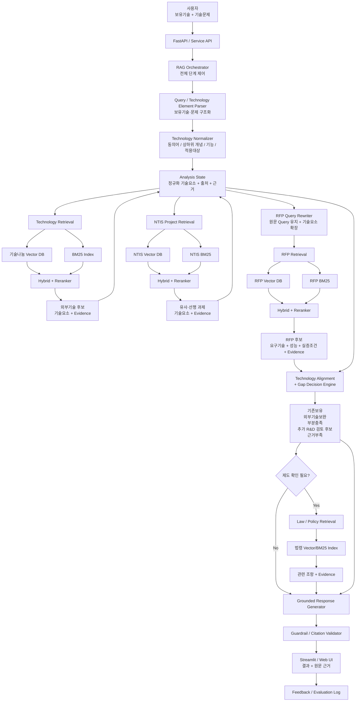

### 한 줄 정의

**제조·자동화 분야 기업의 보유기술과 기술문제를 입력받아, 기술나눔 자료·국가 R&D 과제·RFP·관련 법령을 근거 기반으로 단계적으로** 탐색·분석하고, **외부기술 도입으로 보완 가능한 영역과 추가 R&D가 필요한 기술적 공백을 도출하는 기술기획 지원 서비스**

### 제품 목표

본 프로젝트는 제조·자동화 분야 기업의 보유기술과 기술문제를 입력받아, 기술나눔 자료, NTIS 국가 R&D 과제 및 RFP를 근거 기반으로 탐색·분석하는 기술기획 지원 서비스를 구축하는 것을 목표로 한다.

사용자가 제시한 보유기술과 기술문제를 핵심 기술요소 단위로 구조화한 뒤, 기술나눔 자료에서 외부 도입 가능한 기술을 탐색하고, 유사·선행 국가 R&D 과제를 통해 관련 기술축과 연구개발 맥락을 확인한다. 이후 기업 기술, 외부기술, 선행 R&D 기술요소를 기반으로 국가 R&D RFP를 검색하여 현재 요구되는 연구개발 목표와 기술요건을 분석한다.

최종적으로 기업 보유기술, 외부기술, 국가 R&D 과제 및 RFP 요구기술을 동일한 기술요소 기준으로 비교하여 기존보유, 외부기술보완, 부분충족, 추가 R&D, 근거부족으로 기술적 공백을 구분한다. 각 판단에는 기술소개자료, 특허, NTIS 과제, RFP 등 실제 원문 근거를 함께 제시하고, 기술이전 조건이나 국가 R&D 참여 조건 등 제도적 확인이 필요한 경우 관련 법령에서 관련 제도 근거를 추가로 제공한다.

각 단계의 Retrieval과 근거 추출이 실제 문서에 기반해 정확하게 수행되는지, 그리고 앞 단계에서 확보한 기술요소를 활용한 Cascade Query 재구성이 RFP 검색 성능을 개선하는지를 검증한다.

---

### 배경

제조·자동화 분야의 중소기업은 새로운 기술문제를 해결하거나 신규 연구개발을 추진할 때 자체 자금과 인력만으로 모든 기술을 개발하기 어렵다. 특히 신기술 개발에는 연구인력 확보, 시제품 제작, 시험·인증, 장비 구축, 외주개발 등에 상당한 비용이 필요하며 개발 성공 여부에 대한 불확실성도 존재한다.

이러한 이유로 중소기업은 국가 R&D 사업을 활용하여 **기술개발 비용 부담과 실패 위험을 낮추고, 필요한 기술을 확보해 사업화 가능성을 높일 수 있다.** 정부 지원을 통해 연구개발비 부담을 완화할 수 있을 뿐 아니라 시제품 제작, 실증, 인증 등 후속 단계까지 연결할 수 있으며, 기존 제품의 성능 개선이나 신제품 개발, 기술 국산화 등 기업의 기술경쟁력 확보에도 활용할 수 있다. 특히 연구인력·자금·시험 인프라가 상대적으로 부족한 중소기업에게 국가 R&D는 단순한 재정 지원을 넘어 새로운 기술개발을 추진할 수 있는 중요한 수단이 될 수 있다.

하지만 실제 기술개발 방향을 결정하기 위해서는 단순히 지원사업을 찾는 것만으로는 부족하다. 기업은 다음과 같은 사항을 함께 판단해야 한다.

- 현재 보유기술로 해결 가능한 영역은 무엇인가
- 외부 기술을 도입하여 보완할 수 있는 영역은 무엇인가
- 이미 국가 R&D에서 다뤄지고 있는 관련 기술은 무엇인가
- 현재 어떤 R&D 사업에서 해당 기술을 요구하고 있는가
- 외부 기술을 도입한 이후에도 추가적인 연구개발이 필요한 기술요소는 무엇인가

그러나 이러한 판단에 필요한 정보는 **기업 보유기술, 기술나눔 자료, 특허, 기존 국가 R&D 과제, 현재 공고 및 RFP, 관련 법령** 등 서로 다른 데이터와 문서에 분산되어 있다.

또한 동일한 기술이라도 표현 방식이 서로 다르다. 기업 현장에서는 해결해야 할 문제 중심의 자연어로 표현되는 반면, 특허에서는 발명의 구성과 청구항 중심으로, 국가 R&D 문서에서는 연구목표·개발내용·요구기술 중심으로 작성된다. 따라서 단순 키워드 검색만으로는 기업의 기술문제와 관련 특허, 국가 R&D 과제 사이의 기술적 연관성을 충분히 파악하기 어렵다.

결과적으로 기업 담당자는 여러 시스템과 문서를 개별적으로 검색한 뒤 특허의 기술내용과 RFP의 요구사항을 직접 읽고 비교해야 한다. 특히 **어떤 기술은 현재 보유하고 있고, 어떤 부분은 외부 기술 도입으로 보완할 수 있으며, 어떤 기술은 추가 R&D가 필요한지 판단하는 과정에는 많은 시간과 전문성이 요구된다.**

---

### 사용자 문제

1. **기업의 기술문제와 외부 기술정보 간 표현의 차이**
기업의 기술 표현과 국가 R&D 사업의 요구기술 표현이 다르고, 관련 정보가 공고·RFP·과제·법령 등 여러 문서에 분산되어 있어 기업이 자신의 기술과 연결 가능한 사업을 찾고 판단하는 데 비용이 크다. 
    
    따라서 기업의 자연어 기술문제를 실제 기술요소 단위로 구조화하고, 서로 다른 문서의 표현을 의미적으로 연결할 필요가 있다.
    
2. **외부기술 도입과 추가 R&D 여부를 구분하기 어려움**
특정 기술문제가 발생했을 때 기업은 우선 자체 기술로 해결 가능한지, 외부 기술을 도입해야 하는지, 새로운 연구개발이 필요한지를 판단해야 한다. 
    
    그러나 관련 특허가 존재한다는 사실만으로 해당 문제를 해결할 수 있다고 보기 어렵고, 반대로 특허가 없다는 이유만으로 새로운 연구개발이 반드시 필요한 것도 아니다. 따라서 기업의 보유기술, 외부 특허 기술, 국가 R&D 요구기술을 함께 비교하여 기술문제를 해결할 수 있는 경로를 구분해야 한다.
    
3. **기술이전 정보와 국가 R&D 사업 정보가 분절되어 있음**
기술나눔 특허는 기술이전 가능한 외부 기술을 보여주지만, 해당 기술이 현재 어떤 국가 R&D 수요와 연결되는지는 별도로 확인해야 한다. 국가 R&D RFP 역시 특정 사업의 개발 목표와 요구기술을 제공하지만, 기업이 보유한 기술이나 외부 특허와의 관계를 직접 설명하지 않는다.
    
    따라서 외부기술 탐색에서 확보한 기술요소를 NTIS 유사·선행 과제 탐색에 활용하고, 여기서 확인된 연구주제와 기술용어를 다시 RFP 검색에 활용하여 외부기술·선행 R&D·현재 R&D 수요를 단계적으로 연결한다.
    

> 기업의 기술문제를 해결하기 위해 내부 보유기술, 외부 도입기술, 기존 국가 R&D 사례, 신규 R&D 사업, 관련 제도 정보를 각각 따로 탐색해야 하고, 이 정보들이 서로 다른 문서 구조와 용어로 제공되기 때문에 실제 기술기획 판단까지 연결하는 데 높은 탐색·검토 비용이 발생한다.
> 

---

### 해결 방안

> 
> 
> 
> 사용자의 보유기술과 기술문제를 핵심 기술요소 단위로 구조화한 뒤, 1차적으로 기술나눔 자료를 검색하여 외부기술을 통해 보완할 수 있는 기술요소를 탐색한다.
> 
> 이후 기업 보유기술, 최초 기술문제, 검색된 외부기술 요소를 기반으로 유사·선행 NTIS 국가 R&D 과제를 탐색하여 해당 기술이 국가 R&D에서 어떤 연구주제와 기술용어로 다뤄지고 있는지 확인한다.
> 
> 다음으로 최초 기술문제를 유지하면서 외부기술과 NTIS 과제에서 확보한 기술요소, 현재까지 충족되지 않은 기술요소를 결합해 RFP 검색 Query를 재구성하고, 기술적으로 관련성이 높은 국가 R&D RFP와 요구기술을 탐색한다.
> 
> 최종적으로 기업 보유기술, 외부기술, 유사·선행 NTIS 과제, RFP 요구기술을 동일한 기술요소 기준으로 비교하여 기존보유·외부기술보완·부분충족·추가 R&D 검토 후보·근거부족으로 기술적 공백을 구분한다. 각 판단에는 실제 원문 근거를 연결하여 사용자가 직접 검증할 수 있도록 한다.
> 
> 기술이전 조건, 국가 R&D 참여 조건, 중소기업 적용 조건 등 제도적 확인이 필요한 경우에는 관련 법령을 별도로 검색하여 참고 근거를 제공하되, 법적 적합성이나 지원자격을 자동으로 확정하지 않는다.
> 
1. **보유기술 및 기술문제 구조화**
    - 사용자가 입력한 보유기술과 기술문제를 분석하여 검색에 필요한 핵심 기술요소를 추출한다. 시나리오용 특허등록목록이 존재하는 경우 해당 특허 정보도 함께 활용하여 현재 기업에서 확인되는 기술요소를 정리한다.
2. **Technology RAG**
    - 구조화된 기술문제를 기반으로 기술나눔 특허 및 관련 특허 문서를 검색한다.
    - 검색 결과는 Reranking을 통해 실제 문제와 기술적으로 연관성이 높은 특허를 우선 선정한다.
        - *검색은 Metadata Filter, BM25, Dense Retrieval을 결합한 Hybrid Retrieval을 적용하고, 검색 결과에 Reranking을 수행하여 실제 기술문제와 관련성이 높은 기술을 우선 선정한다. (확정 x)*
    - 선정된 특허에서 단순한 특허명이나 유사도만 사용하는 것이 아니라, 실제 문제 해결에 활용 가능한 핵심 기술요소를 추출한다.
3. **NTIS Project RAG**
    - 기업 보유기술, 기술문제, 검색된 외부기술 요소를 기반으로 2026년 기계 분야 NTIS 국가 R&D 과제를 탐색한다.
    - 목적은 단순히 유사 과제를 추천하는 것이 아니라, 해당 기술이 국가 R&D 영역에서 실제로 어떤 연구주제 및 기술용어로 다뤄지고 있는지 파악하는 것이다.
    - NTIS 검색 결과에서 확보한 기술요소와 연구주제를 이후 RFP Query 확장에 활용한다.
4. **RFP Query 재구성**
    - RFP 검색은 사용자의 최초 질문만 그대로 사용하는 것이 아니라, 다음 정보를 결합하여 Query를 재구성한다.
        - 기업 보유기술
        - 최초 기술문제
        - 외부 기술에서 확인된 기술요소
        - NTIS 선행·유사 과제에서 확인된 기술요소
        - 현재까지 충족되지 않은 기술요소
    - 이를 통해 단순한 산업 키워드가 아니라 실제 기술문제 및 R&D 수요에 가까운 Query를 구성한다.
5. **RFP RAG**
    - 재구성된 Query를 기반으로 국가 R&D RFP를 검색하고, Reranking을 통해 기술적으로 연관성이 높은 RFP를 선정한다.
    - Reranking을 통해 기술적으로 연관성이 높은 RFP를 선정하고 다음 항목을 추출한다.
        - 연구개발 목표
        - 요구기술
        - 개발내용
        - 적용 대상
        - 성능지표
        - 실증 조건
        - 연구개발 범위
    - 검색 결과는 “신청 가능한 사업”이 아니라 “기술적으로 관련성이 높은 R&D 사업 후보”로 제공한다.
6. **기술요소 정렬 및 Technology Gap 분석**
    
    최종적으로 다음 기술정보를 동일한 기술요소 축에서 비교한다.
    
    - 기업 보유기술
    - 외부 기술나눔 기술
    - 유사·선행 NTIS 과제 기술
    - RFP 요구기술

**기술요소 정규화 및 정렬 방식**

기업 입력, 기술나눔 자료, NTIS 과제, RFP에서 추출된 기술표현은 직접 문자열로 비교하지 않고 정규화된 기술요소 단위로 변환한다. MVP에서는 LLM을 활용해 기술명, 동의어, 상·하위 개념, 기능 및 적용대상을 구조화하고, 필요 시 IPC/CPC 또는 NTIS 기술분류를 보조 메타데이터로 활용한다. 동일 기술 여부는 명칭 일치만으로 판단하지 않고 의미적 유사성, 기능, 적용대상, 상·하위 관계를 함께 고려하며 세부 정렬 방식은 구현 실험 후 확정한다.

**판정 우선순위**

1. 해당 기술요소를 판단할 충분한 근거가 없으면 **근거부족**으로 판정한다.
2. 기업 입력 또는 보유특허에서 요구기술을 충분히 충족하면 **기존보유**, 일부만 충족하면 **부분충족**으로 판정한다.
3. 기업에서 충분한 근거가 확인되지 않을 경우 기술나눔 자료를 확인한다. 외부기술이 요구기술을 충분히 보완하면 **외부기술보완**, 일부만 충족하면 **부분충족**으로 판정한다.
4. RFP에서 해당 기술요소가 명확하게 요구되지만 기업 보유기술과 검색된 외부기술에서 충분한 충족 근거를 확인하지 못한 경우에만 **추가 R&D 검토 후보**로 판정한다.
5. RFP 요구 자체가 명확하지 않거나 현재 자료만으로 충족 여부를 판단하기 어려우면 **근거부족**으로 판정한다.

**판정 기준**

- **기존보유**
사용자가 제공한 보유기술 또는 시나리오 기업의 특허자료에서 해당 기술요소가 확인되는 경우
- **외부기술보완**
기업에서는 확인되지 않지만 기술나눔 자료에서 해당 기술을 직접적으로 보완할 수 있는 근거가 확인되는 경우
- **부분충족**
기업 또는 외부기술이 RFP 요구기술의 일부만 충족하거나 성능·적용범위·구현조건이 충분하지 않은 경우
- **추가 R&D 검토 후보**
RFP에서 해당 기술요소가 명확하게 요구되지만 기업 보유기술과 검색된 외부기술에서 충분한 충족 근거를 확인하지 못한 경우. 이는 현재 검색 corpus에서 추가 개발 검토 필요성이 확인되었다는 의미이며, 반드시 신규 R&D가 필요하다는 확정 판단은 아니다.
- **근거부족**
RFP 요구 자체가 명확하지 않거나 현재 데이터만으로 기술 보유 또는 충족 여부를 판단하기 어려운 경우

---

1. **법령 및 제도 근거 확인**
    - Technology Gap 분석 이후 결과가 기술이전 조건, 국가 R&D 참여 조건, 중소기업 적용 조건 등 제도적 확인으로 이어지는 경우 관련 법령을 검색한다.
    - 법령은 기술적 Gap을 결정하는 데이터가 아니라 최종 의사결정을 보조하는 근거로 사용한다.
    - 예:
    
    시스템은 법적 판단을 단정하지 않고 관련 조항과 추가 검토 필요사항을 제시한다.
        - 기술나눔 기술의 이전·사용 관련 조건 확인
        - 국가 R&D 수행 또는 참여 관련 규정 확인
        - 중소기업 대상 지원·적용 조건 확인
        - 사용자의 추가적인 제도·자격 질문에 대한 근거 제공
2. **근거 기반 결과 제공**
    - 최종 결과에서는 단순 유사도 점수 대신 다음 내용을 제공한다.
    1. 현재 기업 보유기술
    2. 도입을 검토할 수 있는 외부기술
    3. 관련 유사·선행 국가 R&D 과제
    4. 기술적으로 관련된 RFP 후보
    5. Technology Gap
    6. 필요한 경우 관련 제도 및 법령 근거
    
    각 판단에는 해당 판단을 뒷받침하는 원문 문장 또는 문서 위치를 함께 제공하여 사용자가 결과를 직접 검증할 수 있도록 한다.
    

---

### 차별점

본 서비스는 단순한 특허 검색이나 국가 R&D 공고 추천 서비스가 아닌,

기업의 실제 기술문제를 출발점으로 외부 기술나눔 자료, 국가 R&D 수행과제, 현재 RFP를 단계적으로 연결하는 Cascade Retrieval 구조를 사용한다.

특히 앞 단계에서 확보한 기술요소를 다음 단계의 검색 Query에 다시 활용하여 검색 범위를 점진적으로 구체화한다.

최종적으로 기업 보유기술, 외부기술, 선행 R&D 기술, RFP 요구기술을 기술요소 단위로 비교하여 단순한 문서 유사도 대신 다음과 같은 기술기획 판단을 제공한다.

- 현재 가지고 있는 기술
- 외부 도입을 통해 확보 가능한 기술
- 일부만 충족되는 기술
- 추가 연구개발이 필요한 기술
- 현재 근거로 판단할 수 없는 기술

즉 “무슨 문서가 비슷한가”보다 “기업이 다음으로 무엇을 검토해야 하는가”를 제공하는 것을 차별점으로 한다.

---

### 타겟 사용자

1차 타겟은 자체 기술 또는 등록특허를 보유하고 있으나, 외부 기술 탐색 및 국가 R&D 사업 분석을 전담할 전문인력이 부족한 제조·자동화 분야 기업의 R&D 담당자로 설정한다.

주요 사용자는 다음과 같은 상황에 있는 기업이다.

- 특정 기술문제를 해결할 외부 기술을 찾고자 하는 경우
- 보유기술을 기반으로 추가 연구개발 방향을 검토하는 경우
- 기술이전과 자체 연구개발 중 어떤 방향을 검토해야 하는지 판단하려는 경우
- 자사 기술과 연관된 국가 R&D 기술수요 및 사업을 탐색하려는 경우

---

### 사용자 시나리오

제조 자동화 시스템을 개발하는 중소기업 A사는 다음 기술을 보유하고 있다.

- SLAM 기반 자율주행
- 영상 객체 인식
- 경로계획

기업은 작업자와 지게차가 함께 이동하는 제조환경에서 주변 객체 인식과 안전주행 성능을 향상시키고자 한다.

R&D 담당자는 서비스에 보유기술과 기술문제를 입력한다.

시스템은 입력 내용을 동적 객체 인지, 센서융합, 충돌 회피, 안전주행 등의 핵심 기술요소로 구조화한다.

기술나눔 자료를 검색한 결과 LiDAR 기반 객체 인지 및 센서융합 관련 기술이 외부기술 후보로 탐색된다.

이후 기업 기술과 외부기술 요소를 기반으로 NTIS 국가 R&D 과제를 탐색하여 제조환경 자율주행, 동적 객체 추적, 다중센서 융합 등의 관련 연구주제를 확인한다.

해당 기술요소를 활용하여 국가 R&D RFP를 검색한 결과 동적 객체예측, Edge AI 기반 실시간 추론, 제조현장 실증 등의 기술 요구사항이 확인된다.

시스템은 최종적으로 다음과 같이 분석한다.

- SLAM: 기존보유
- 영상 객체 인식: 기존보유
- LiDAR 객체 인지: 외부기술보완
- 센서융합: 외부기술보완
- 동적 객체예측: 추가 R&D 검토 후보
- Edge AI 실시간 추론: 추가 R&D 검토 후보
- 제조현장 실증: 추가 R&D 검토 후보

담당자는 각 판단에 연결된 기술소개자료, NTIS 과제, RFP 원문 근거를 확인하고 외부 기술이전과 후속 R&D 기획 방향을 검토할 수 있다.

---

### 핵심 지표

핵심 기술평가는 시스템이 실제 문서에서 필요한 근거를 정확하게 검색하고, 해당 근거 범위 안에서 판단을 생성했는지를 중심으로 수행한다.

**Retrieval 평가**

- 정답 문서가 Top-K 검색 결과에 포함되는지 평가
- 정답 근거가 포함된 청크가 실제 검색되었는지 평가

주요 지표:

- Recall@5
- Recall@10
- MRR
- Evidence Hit Rate

**Cascade Ablation 평가**

단계형 Query 재구성의 효과를 검증하기 위해 두 조건의 RFP 검색 성능을 비교한다.

- Baseline: 최초 사용자 입력(보유기술 + 기술문제)만 사용
- Cascade: 최초 입력 + 외부기술 요소 + NTIS 기술요소 + 미충족 기술요소 사용비교 지표: Recall@5, Recall@10, MRR이를 통해 앞 단계에서 확보한 기술요소를 활용한 Query 재구성이 실제 RFP 검색 성능을 개선하는지 검증한다.

**근거 정확성 평가**

- 최종 판단에 인용된 문서가 실제 주장과 일치하는지 평가
- 인용 문장 또는 청크가 해당 판단을 직접 뒷받침하는지 평가
- 문서에 없는 내용을 근거처럼 제시하지 않는지 평가

주요 지표:

- Citation Accuracy
- Faithfulness
- Unsupported Claim Rate

**Technology Gap 근거 평가**

기존보유, 외부기술보완, 부분충족, 추가 R&D, 근거부족의 각 판정이 실제 문서 근거로 뒷받침되는지 평가한다.

분류 자체의 정확도뿐 아니라 해당 Label에 연결된 Evidence가 올바른지를 함께 확인한다.

단계별 평가

*Technology RAG:*

- 관련 외부기술 문서를 찾았는가
- 실제 보완 기술요소가 포함된 근거를 가져왔는가

*NTIS Project RAG:*

- 관련 국가 R&D 과제를 찾았는가
- 실제 연구주제 및 기술요소가 포함된 근거를 가져왔는가

*RFP RAG:*

- 관련 RFP를 찾았는가
- 실제 요구기술, 성능지표, 실증조건이 포함된 근거를 가져왔는가

Legal / Policy Retrieval:

- 실제 관련 법령 조항을 정확히 검색했는가
- 해당 조항의 의미를 근거 범위를 넘어 과도하게 해석하지 않았는가

핵심 평가 질문은 다음과 같다.

“시스템이 올바른 문서를 찾고, 그 문서 안에서 필요한 근거를 정확히 가져와, 해당 근거의 범위 안에서만 판단을 생성했는가?”

---

### 리스크

1. 기술 유사성과 실제 적용 가능성의 차이
    
    검색된 기술이 의미적으로 유사하더라도 실제 기업환경에서 적용 가능하다는 의미는 아니다.
    
    따라서 시스템은 “도입 가능”을 확정적으로 표현하지 않고 기술적 연관성과 검토 가능성을 중심으로 결과를 제시한다.
    
2. 기업 보유기술 정보의 한계
    
    사용자가 입력한 보유기술과 시나리오용 특허목록은 기업의 전체 기술역량을 완전히 표현하지 못할 수 있다.
    
    따라서 확인되지 않은 기술을 “보유하지 않음”으로 단정하지 않고 “제공된 기술정보에서 확인되지 않음”으로 표현한다.
    
3. NTIS 과제와 현재 기술수요의 차이
    
    유사한 국가 R&D 과제가 존재한다는 사실만으로 현재 기업의 문제와 직접적으로 연결된다고 판단할 수 없다.
    
    NTIS 과제는 유사·선행 연구 및 검색 Query 확장 근거로 활용하며 직접적인 Gap 판정의 단독 근거로 사용하지 않는다.
    
4. RFP와 실제 지원 가능성의 차이
    
    기술적으로 관련성이 높은 RFP라도 기업 규모, 신청자격, TRL, 주관기관 요건, 컨소시엄 조건 등에 따라 실제 참여가 불가능할 수 있다.
    
    따라서 시스템은 “신청 가능한 사업”이 아닌 “기술적으로 관련성이 높은 사업 후보”로 결과를 제공한다.
    
5. 법령 해석 위험
    
    검색된 법령 조항만으로 법적 적합성이나 지원자격을 자동 판정할 수 없다.
    
    법령은 관련 제도 근거와 추가 확인사항을 제공하는 용도로 제한한다.
    
6. Cascade Retrieval의 오류 전파
    
    앞 단계의 잘못된 검색 결과가 이후 검색 Query에 반영될 경우 오류가 연속적으로 전파될 수 있다.
    
    이를 방지하기 위해 RFP 검색 시 최초 사용자의 기술문제를 항상 유지하고, 외부기술과 NTIS 결과는 Query 확장정보로 사용한다. 
    
    또한 각 Retrieval 단계의 검색성능을 독립적으로 평가한다.
    
7. 근거 없는 LLM 추론
    
    LLM이 실제 문서에 존재하지 않는 기술이나 판단을 생성할 수 있다.
    
    따라서 최종 결과는 검색된 근거 범위 내에서만 생성하며, 충분한 근거를 확인할 수 없는 경우 명시적으로 ‘근거부족’으로 처리한다.
    

---