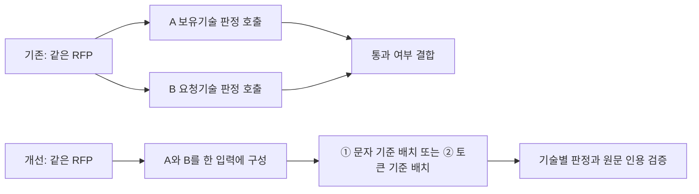

# RFP 호출 구조 개선: 발표용 설명과 추가 검증

이 문서는 추가 검증 당시 기록입니다. 이후 ②를 기본값으로 선택했습니다.
최종 적용 상태는 [전체 변경 정리](LLM_CALL_OPTIMIZATION_20261018.md),
공유용 실측 자료는 [평가 JSON](evaluations/llm_call_optimization_20261018.json)을 참고하세요.

작성일: 2026-10-18. 기반 모델은 기존·개선 모두 `gpt-5.6-luna`다. 모델 교체나 파인튜닝의 효과가 아니라 RFP 관련성 판정의 요청 구성·배치 방식 개선을 비교했다.

## 발표에서 먼저 전달할 내용

> 같은 모델을 사용하면서, 문서별로 나누어 호출하던 보유기술 A·요청기술 B 판정을 한 요청으로 통합하고, 문자 수 대신 예상 토큰 수로 배치했다. 고정한 10문항의 RFP 판정 구간에서 ②는 기존 대비 호출 78.1%, 토큰 60.8%, 추정 비용 63.1%, 평균 소요 시간 49.6%를 줄였다. 명시 정답 회수는 두 방식 모두 3/6이었다. 이는 품질 향상이나 동등성을 입증한 결과는 아니다.

## 어디를 어떻게 수정했는가

| 변경 | 기존 | ① | ② | 코드 |
| --- | --- | --- | --- | --- |
| A/B 판정 단위 | 동일 문서를 A용·B용으로 나누어 판정 | A/B 기술 목록을 같은 문서에 함께 제공하고 각각 판정 | ①과 동일 | `app/rfp_rag/retrieval/eligibility.py`, `_judge_sections()` |
| 배치 크기 기준 | 최대 5개, 사용자 메시지 24,000자 기준 | 동일 문자 기준 | 메시지·응답 스키마의 예상 토큰 + 2,048 여유분, 32,000토큰 예산 | `app/common/relevance_batch.py`, `map()` |
| 토큰 계산 | 없음 | 없음 | 로컬 `o200k_base` 추정, 실제 과금은 API usage로 측정 | `eligibility.py`, `_count_tokens()` |
| 혼합·잘못된 응답 방지 | 개별 기술 판정 | 기술 인덱스·job 인덱스·원문 인용 검증 | ①과 동일 | `_evaluate()`, `_quote_sections()`, 배치 응답 검증 |
| 배치 오류 처리 | 기존 방식 | 누락·중복 등 배치 형식 오류 시 개별 호출 재시도 | ①과 동일 | `BatchedRelevanceLLM.map()` |

②는 문서를 요약·절단하거나 후보 수를 줄이는 방식이 아니다. 단일 문서가 예산보다 커도 원문을 유지해 단독 호출한다. 최대 배치 크기는 여전히 5개이지만, 한국어 원문의 문자 수와 토큰 수 차이를 반영해 24,000자 제한으로 나뉘던 요청을 더 묶을 수 있다. 각 기술의 독립 판정과 인용 검증은 필요하다. 배치가 커지면 판정이 달라질 수 있어 추가 검증을 했다.

## 동일 검색 후보를 고정한 10문항 비교

| 방식 | 호출 | 사용 토큰 | 추정 USD | 평균 RFP 판정 시간 | 명시 정답 회수 |
| --- | ---: | ---: | ---: | ---: | ---: |
| 기존 | 581 | 6,604,978 | $1.8151 | 197.2초 | 3/6 |
| ① 통합·문자 | 235 | 2,732,926 | $0.7529 | 132.2초 | 3/6 |
| ② 통합·토큰 | 127 | 2,591,557 | $0.6703 | 99.4초 | 3/6 |

②는 ①보다 호출 46.0%, 토큰 5.2%, 비용 11.0%, 평균 시간 24.8% 감소했다. 입력 해석과 검색 후보는 질문별 한 번 생성해 고정했고, 모든 방식에 같은 원문을 제공했다. 10문항 중 명시적인 PARTIAL·DIRECT 정답 RFP는 6개다. 나머지 문항을 전체 음성 정답으로 취급하지 않았다. 각 방식 1회 실행이며 시간은 동시 작업 6개 조건이다. 원래 ORC 질문과 Q7을 포함하고 완료 결과를 재사용하도록 선택했으므로 무작위 대표 표본은 아니다.

## 추가 검증: 같은 5개 후보 묶음의 반복 비교

Q1·Q7·Q13·Q14에서 원래 검색 순서상 같은 5개 묶음을 유지했다. Q1은 과거 히트펌프 오탐, 나머지는 기존 ①·② 간 판정 차이를 기준으로 선정했다. 두 방식에 같은 질문·원문·순서를 제공하고 seed 0·1로 각 1회 실행했다. seed 0은 기존 설정 재실행, seed 1은 설정 변화에 대한 민감도 진단이다. 앱 디스크 캐시는 사용하지 않았고 서버 캐시 사용량은 비용에 반영했다. 총 16개 묶음 실행, 방식별 40개 문항-후보 판정이다. 대표 정확도 검증이 아니라 경계 사례의 안정성 진단이다.

| 방식 | 추가 호출 | 추가 토큰 | 추가 추정 USD | seed 0/1 판정 일치 | 기존 seed 0과 재실행 일치 |
| --- | ---: | ---: | ---: | ---: | ---: |
| ① | 28 | 315,321 | $0.0367 | 19/20 | 17/20 |
| ② | 16 | 301,062 | $0.0251 | 19/20 | 17/20 |

같은 seed에서 ①·②의 판정 일치는 34/40이다. 판정 일치율은 정확도가 아니다. 두 방식이 같은 오답을 내더라도 일치로 계산된다.

| 진단 사례 | 후보 | ① seed 0 / 1 | ② seed 0 / 1 |
| --- | --- | --- | --- |
| Q1 | 10RT급 히트펌프-데시컨트 하이브리드 냉·난방/제습 통합 시스템 기술 개발 | 제외 / 제외 | 제외 / 제외 |
| Q7 | 50% 이상 에너지 저감을 위한 용해로 온도변화 5% 이내 폐열활용공정 개발 | 제외 / 제외 | 제외 / 통과 |
| Q13 | 정밀 공정용 압전·저항·산화물계 기능성 세라믹 소재·부품 개발 및 양산검증 | 제외 / 제외 | 제외 / 제외 |
| Q14 | 가열로 중저온 배가스 폐열 회수용 200kW급 고효율 ORC 터빈 발전 시스템 개발 | 제외 / 제외 | 통과 / 통과 |

이 표의 통과·제외는 현행 관련성 필터의 출력이다. 선정한 네 후보 모두에 독립적인 완전 정답 라벨이 있는 것은 아니므로 오탐률로 환산하지 않았다.

## ORC 한 문항 전체 응답 비교: 기존 자료

| 방식 | 전체 호출 | 전체 토큰 | 추정 USD | 전체 응답 시간 |
| --- | ---: | ---: | ---: | ---: |
| 기존 | 97 | 956,740 | $0.2954 | 704.9초 |
| ① | 68 | 611,409 | $0.1997 | 577.4초 |
| ② | 47 | 547,317 | $0.1730 | 535.6초 |

②는 기존 대비 호출 51.5%, 토큰 42.8%, 비용 41.4%, 전체 시간 24.0% 감소했다. 이는 질문 해석부터 최종 답변까지의 실제 관측이다. 다만 NTIS 응답에 따라 RFP 검색 질의와 후보가 달랐으므로 RFP 코드 수정만의 인과 효과로 발표하면 안 된다. 한 문항·한 번 측정이며, 과거 실행에서 ②가 히트펌프 후보도 통과시킨 사례가 있었다. 이번 추가 검증은 당시 전체 파이프라인을 재현한 실험이 아니라 고정 후보에서의 판정 비교다.

## 발표에서 지켜야 할 해석

- “정확도 유지” 대신 “명시 정답 문서 회수는 기존과 같은 3/6”이라고 설명한다. 통계적 동등성은 입증하지 않았다.
- Q7의 `abstention`은 확인되지 않은 직접 대응을 확정하지 말라는 취지다. CSV는 전체 코퍼스에 후보가 없다고 단정하지 않는다. 후보 반환 자체를 곧바로 오답으로 본 이전 권장 근거는 지나치게 엄격했다. 원문의 기능·대상과 최종 설명을 검토해야 한다.
- Q3·Q9·Q19 정답은 검색 후보에 존재했지만 A/B 근거 부족으로 탈락했다. PARTIAL 정답 허용과 현행 필터의 엄격한 A/B 조건 차이가 남아 있다.
- 시간은 10문항 RFP 판정과 한 문항 전체 답변을 구분한다. 비용은 청구액이 아닌 API usage 기반 추정액이다.
- 실제 서버 캐시가 비용에 영향을 줬다. 전체 감소를 요청 합치기만의 효과로 단정하지 않는다.
- ③은 이번 10문항에서 원문 축소가 발동하지 않았다. 다만 excerpt 모드의 추가 지시문은 적용됐으므로 ①과의 차이를 축소 효과로 설명할 수 없다.
- 네 경계 사례의 반복 결과로 전체 사용자 질의의 안정성을 일반화하지 않는다. 독립 전문가 판정·블라인드 라벨링은 하지 않았다.

## 검증 범위·현재 상태

- 로컬 단위·통합 테스트: `python -m unittest discover -s tests`, 255개 통과(NTIS 배치 추출 테스트 6개 포함). 의미적 추천 정확도를 입증하는 테스트는 아니다.
- 비교 수치·추가 호출 usage·원본 CSV SHA-256는 [평가 요약 JSON](evaluations/llm_call_optimization_20261018.json)에 보존했다.
- 2026-10-18 정리에서 `outputs`의 원시 출력·캐시·동결 문서 스냅샷은 삭제했다. 아래 수치는 당시 실행의 측정 기록이다.
- 실제 모델 호출 구조를 비교했으며 새 모델을 학습하거나 교체하지 않았다. 기본값은 아직 ①이고 ②는 명시적 옵션으로 사용 가능하다.
- GitHub push 및 추가 전체 답변 생성은 하지 않았다.

가격 기준: [OpenAI 공식 요금표](https://developers.openai.com/api/docs/pricing). 단가는 입력 $0.20·캐시 읽기 $0.02·캐시 쓰기 $0.25·출력 $1.20/100만 토큰이다.

## 전체 LLM 호출 절감: 다음 병목과 실제 추가 변경

목표는 전체 요청의 LLM 호출 감소다. RFP 판정만의 효율과 전체 응답의 효율을 구분해 관리한다. 이전 ORC 전체 실행의 단계별 실제 호출은 다음과 같다. 모델·LLM 요청만 세며 임베딩 API는 별도다.

| 단계 | 기존 | ① 적용 실행 | ② 적용 실행 |
| --- | ---: | ---: | ---: |
| 입력 해석 | 1 | 1 | 1 |
| 나눔기술 검색·분석 | 1 | 1 | 1 |
| NTIS | 16 | 19 | 19 |
| RFP | 70 | 36 | 17 |
| Gap·최종 답변 | 9 | 11 | 9 |
| 전체 | 97 | 68 | 47 |

② 실행의 NTIS 19회는 질의 구조화 1 + 관련성 판정 6 + 기술 추출 10 + 정규화 1 + 연구축 생성 1이었다. Gap·답변 9회는 요구기술 추출 2 + 정합성 판정 5 + 답변 생성 1 + 근거 검토 1이었다. 입력 해석과 나눔기술은 각 1회이고 Gap 정합성 판정은 이미 묶음 처리 중이다. 따라서 과제별 반복이 남은 NTIS 기술 추출을 추가 개선 대상으로 골랐다.

변경 위치: `app/ntis_rag/generation/analysis.py`의 `extract_all_project_tech()`와 신규 `app/ntis_rag/generation/batched_extraction.py`. 과제 최대 5개를 묶고 입력 인덱스로 원래 순서를 복원한다. 근거 문장이 해당 과제 원문에 있는지 검증하고, 실패한 과제만 개별 재처리한다. 24,000자 예산을 넘으면 묶음을 나누며 원문은 절단하지 않는다.

| 같은 NTIS 과제 10개 추출 | 호출 | 토큰 | 추정 USD | API 응답 시간 합계 |
| --- | ---: | ---: | ---: | ---: |
| 기존 개별 추출 | 10 | 12,254 | $0.009116 | 53.1초 |
| 배치 추출·검증 재처리 포함 | 3 | 9,839 | $0.006378 | 28.2초 |

호출 70.0%, 토큰 19.7%, 추정 비용 30.0%, API 응답 시간 합계 46.9% 감소를 관측했다. 배치 두 번과 근거 검증 실패 후 개별 추출 한 번을 포함한다. 최종 과제 10개의 오류는 0개였고 근거는 각 원문과 대조했다. 추가 API 3회의 추정 비용은 약 $0.0064였다.

**추출 기술요소 수는 기존 93개에서 57개로 달랐다.** 요소 수가 정확도를 의미하지는 않지만 필수 내용의 누락 여부도 확인되지 않았다. 따라서 호출 감소만 보고 기본값을 바꾸지 않았다. `NTIS_EXTRACTION_BATCH_SIZE=5`로 실험할 수 있고 기본값 1은 개별 추출이다. 이 변경 이후 정규화·연구축·Gap·최종 답변까지 전체 재실행하지 않았으므로 새로운 전체 호출 수·전체 비용·전체 답변 시간은 실측하지 않았다. 47회에서 7회를 단순 차감한 값을 새 전체 실측으로 제시하면 안 된다.

RFP의 추가 반복에서도 Q14의 공조기 진단→원전 이상감시 질문에 ②는 ORC RFP를 두 번 통과시켰다. 해당 응답은 적용 대상 차이를 인정하면서 넓은 상태 감시·진단 기능만으로 similar를 주었다. 원문 대조 기준에서 과도한 일반화가 의심되는 재현 사례이며, 독립 전문가 정답은 아직 없다. 효율 측면에서 ②가 앞선다는 결론과 별도로 품질 검증이 필요하다.

발표 권장 표현: “전체 응답의 반복 호출을 줄이기 위해 RFP A/B 통합·토큰 배치를 검증했고, 다음 병목인 NTIS 과제 추출도 배치화했다. 기존 전체 실행에서는 97→47회, 추가 NTIS 추출 구간에서는 10→3회를 관측했다. 전체 호출 절감 수치와 개별 구간 수치는 서로 다른 실험이며, 품질 동등성은 추가 검증 과제로 남아 있다.”
